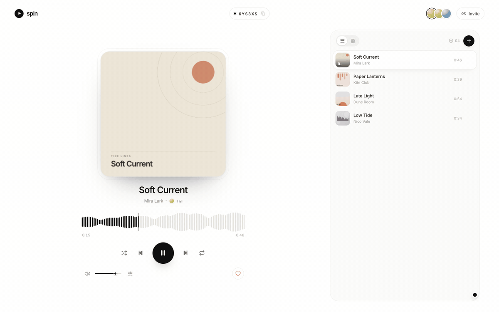
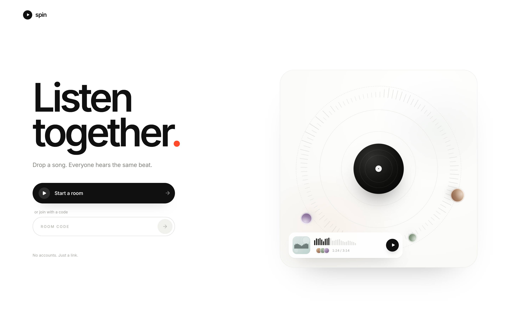
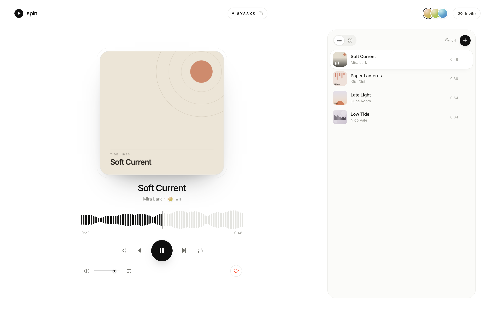
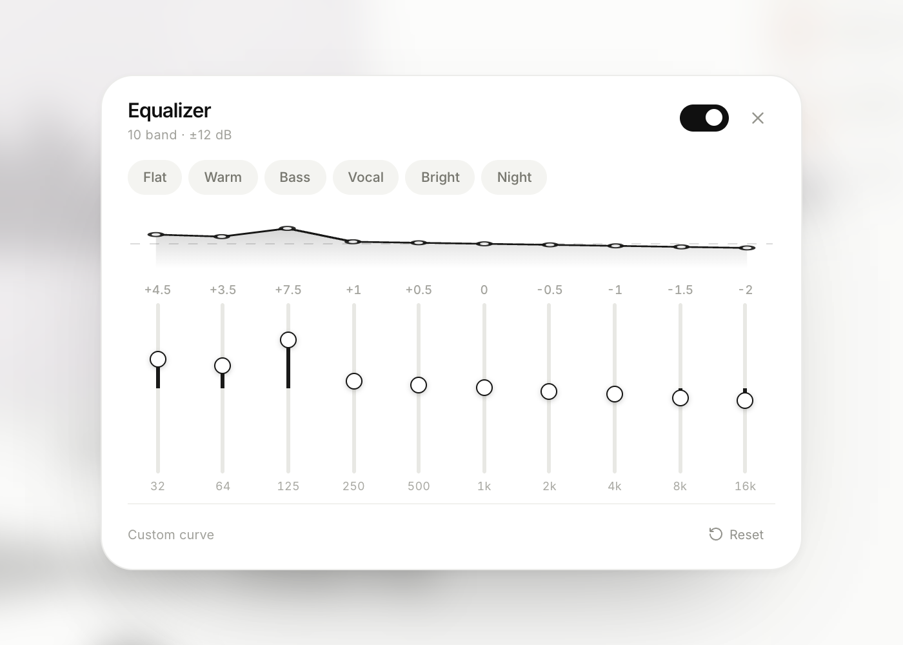
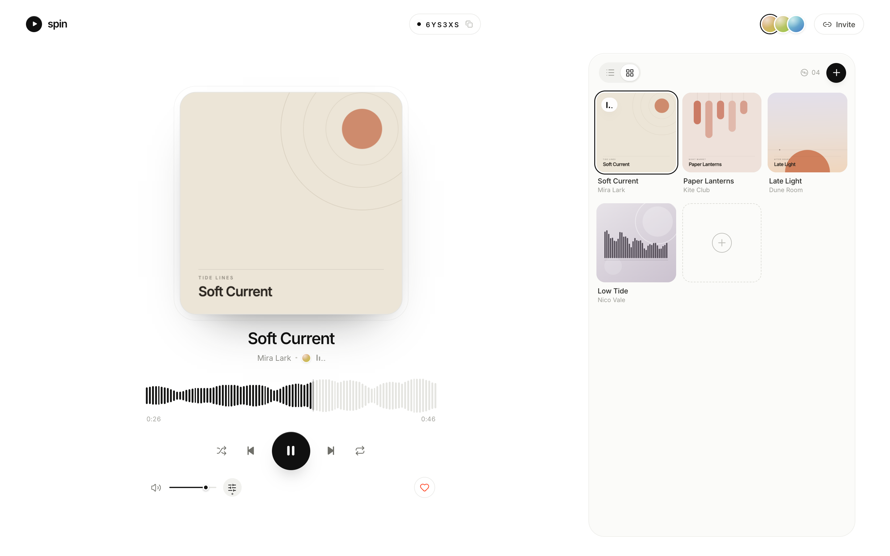
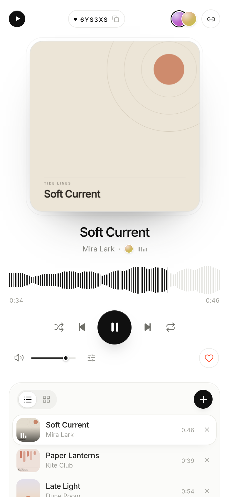
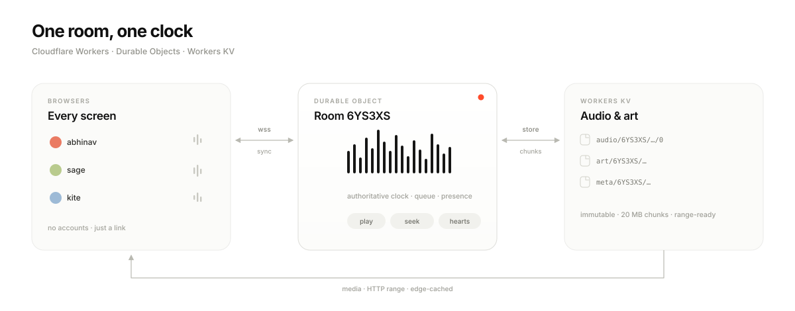

<p align="center">
  
</p>

<p align="center">
  <strong>One room, one song, same beat.</strong>
</p>

<p align="center">
  <a href="https://abhinav-prabhakar.github.io/Spin/"></a>
  
  
  
</p>

<p align="center">
  
  
  
  
</p>

<p align="center">
  
</p>

<p align="center"><sub>A real room, not a screenshot. Everything below is the live app.</sub></p>

Spin is a quiet place to listen with friends. Share a six-character link, drop in MP3s, and every screen hears the same second — with a proper ten-band equalizer and nothing else. No accounts, no library, no feed.

- **Same second.** One Durable Object owns the clock; late joiners, reconnects and phone browsers all land exactly where the room is.
- **Ten bands.** ±12 dB, six presets, and your curve is saved on this device. Built on a real Web Audio filter chain.
- **Just a link.** Drag to reorder the queue, send hearts, see who is listening, copy an invite. That is the whole product.

<p align="center">
  
</p>

<p align="center"><sub>No sign-up. A room is a link.</sub></p>

<p align="center">
  
</p>

<p align="center"><sub>Artwork, a waveform you can scrub, one shared queue.</sub></p>

<p align="center">
  
</p>

<p align="center"><sub>Ten bands, ±12 dB. Warm, Vocal, Bass, Bright, Night — or your own curve.</sub></p>

<p align="center">
  
</p>

<p align="center"><sub>List for the set, grid for the covers.</sub></p>

<p align="center">
  
</p>

<p align="center"><sub>The same room, one thumb.</sub></p>

## Under the hood

One Worker routes rooms, uploads and media. Each room is a Durable Object with an authoritative clock, presence and a storage alarm that advances the queue. Audio and artwork live in Workers KV, chunked so Range requests and seeking stay instant.

<p align="center">
  
</p>

## Run it

```bash
npm install
npm run dev          # app on :5173, Worker on :8790
npm run typecheck    # client + Worker
npm run build:pages  # static build in docs/
npm run deploy:api   # wrangler deploy
```

The Pages build reads `VITE_BASE` and `VITE_API_ORIGIN` from `.env.pages`.

<p align="center"><sub>MIT · made for headphones.</sub></p>
